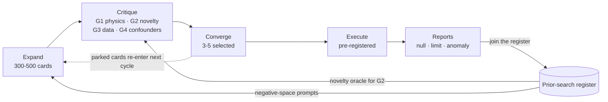
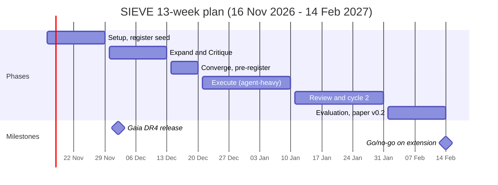

# SIEVE: AI-Driven Hypothesis Generation for Detecting Extraterrestrial Life in Existing Archival Data

*Working Paper v0.1 — living document*

Nov 7, 2026 · Carsten Mielke · Living document: https://claude.ai/artifact/PwyNvKFqN9Ne1z1AqNLBG7 · Exported from v0.1 (doc rev 21)

## Abstract

SIEVE (Systematic Ideation and Evaluation of hypotheses against Existing data) treats the search for extraterrestrial life as a hypothesis-generation problem over data that already exists. AI-driven mining of astronomical archives is now mainstream: machine-learning sweeps of the TESS archive alone produced more than 10,000 new planet candidates in 2026. Almost all of this effort, however, asks one question (where are the planets?) with ever better detectors.

SIEVE inverts the order. An LLM-based ideation pipeline built on the Expand–Critique–Converge (ECC) framework first generates a large, structured space of life-detection hypotheses without regard to data availability. Each hypothesis is then passed through three filters: an automated novelty check against the literature (NASA ADS, OpenAlex, arXiv), a data-availability check against public archives (MAST, Gaia, IRSA, Breakthrough Listen, PDS and others), and a feasibility score calibrated to a one-person team with laptop and cloud compute. Surviving hypotheses are executed as pre-registered analyses with explicit null-result reporting.

The expected outputs after three months are (1) a public, versioned catalogue of hypothesis cards, (2) a register of prior archival searches that the novelty filter uses, (3) one to three executed proof-of-concept analyses on catalogue-level data, and (4) an evaluation of the method itself, including a blind rediscovery test against known archival searches. A second stage specifies what it would take to move from methodology to a credible detection claim.

## 1. Introduction and Motivation

The search for life beyond Earth is data-rich but hypothesis-poor: public archives hold far more observations than anyone has asked specific questions of. The bottleneck is no longer collecting photons but deciding what to look for in the photons already collected.

**Archival mining works, and it is now mainstream.** The T16 Planet Hunt processed [83.7 million TESS Cycle-1 light curves](https://collaborate.princeton.edu/en/publications/the-t16-planet-hunt-10000-new-planet-candidates-from-tess-cycle-1/) with a machine-learning-assisted pipeline and reported 11,554 planet candidates, 10,091 of them new, more than doubling the known TESS candidates (Roth et al., ApJS 284, May 2026). Project Hephaistos II searched [about five million Gaia DR3, 2MASS and WISE sources](https://arxiv.org/html/2405.02927v1) for partial Dyson spheres and found seven M-dwarf candidates (Suazo et al., MNRAS 2024). Painter et al. re-searched [9,684 observation cadences of 3,077 stars](https://doaj.org/article/ce21a7156af84701a6fc82006bf77c0a) in the Breakthrough Listen Green Bank archive with a new algorithm (AJ 169, 2025). A re-analysis of Cassini dust-analyser data from a single 2008 plume flyby revealed [complex organic molecules in freshly ejected Enceladus ice grains](https://www.sciencedaily.com/releases/2025/10/251001092210.htm?rand=14460) (Khawaja et al., Nature Astronomy, October 2025), seventeen years after the data were taken. The pattern in every case: old data plus a new question or a new method equals a new result.

**What these efforts share is a single, pre-chosen hypothesis.** Planets transit; Dyson spheres emit waste heat; transmitters produce narrowband drifting signals; oceans leak organics. Each team picks one hypothesis by intuition and then builds a detector for it. The hypothesis space itself, the set of all questions one could ask of existing data about life, is explored slowly, informally and by a small community. Nobody has treated that space as the object of systematic, tool-supported search.

**SIEVE's archive-first principle inverts the usual order.** Generate hypotheses first, deliberately ignoring whether data exist. Then filter: (a) has this been done, (b) can it be tested on data that already exist, (c) can a one-person team with cloud compute do it in weeks. Only then analyse. The filter, not the detector, is where the method lives.

**Why now.** Four things converged in 2026. First, LLM-based hypothesis generation has matured into a documented research instrument: Google's Co-Scientist, a multi-agent system for [structured scientific thinking and hypothesis generation](https://cris.huji.ac.il/en/publications/accelerating-scientific-discovery-with-co-scientist/), appeared in Nature in 2026, and agentic frameworks such as Mephisto have demonstrated [end-to-end agentic research in astronomy](https://papers.cool/arxiv/2409.14807). Second, literature APIs (NASA ADS, OpenAlex, arXiv) make automated novelty checks practical. Third, a wave of archive releases lands inside this project's three-month window: Gaia DR4 on [2 December 2026, with the full epoch time series for 5.5 years of observations](https://www.cosmos.esa.int/web/gaia/news); Euclid DR1 in a first stage [in November 2026 covering about 1,900 square degrees](https://www.cosmos.esa.int/web/euclid/dr1-timeline); SPHEREx spectral images released [weekly through IRSA](https://irsa.ipac.caltech.edu/data/SPHEREx/docs/overview_qr.html); and Rubin Observatory's public alert stream, which [issued 800,000 alerts on its first night, 24 February 2026](https://www6.slac.stanford.edu/news/2026-02-25-nsf-doe-vera-c-rubin-observatory-launches-real-time-discovery-machine-monitoring), with the ten-year LSST under way since the end of June 2026. Fourth, agentic coding tools let one person run a pipeline that used to need a team.

**Scope and expectation.** We expect no detection of life. The deliverables are a reusable method, a public hypothesis catalogue, well-documented null results and, possibly, anomalies worth follow-up. Section 8 describes what it would take to go further.

## 2. Background and Related Work

Three lessons run through the prior work below: no single signature is ever decisive, confounders dominate every candidate list, and the normal product of a search is an upper limit, not a detection.

### 2.1 AI mining of astronomical archives

Machine learning has been finding planets in old data since Kepler-90i (2017). The current state of the art is the T16 Planet Hunt, whose [semi-automated pipeline with random-forest classifiers](https://www.academicjobs.com/research-publication-news/ml-discovers-10000-exoplanet-candidates-or-academicjobs-15536) swept TESS Cycle-1 full-frame images down to 16th magnitude and produced 11,554 candidates, [10,091 of them new](https://astrobiology.com/2026/05/03/the-t16-planet-hunt-10000-new-planet-candidates-from-tess-cycle-1-and-the-confirmation-of-a-hot-jupiter-around-tic-183374187/). All of these candidates have periods between 0.5 and 27 days, so none is a habitable-zone world; the result is a census, not a life search. The broader lesson for SIEVE is methodological: a question that the original pipelines did not ask (faint stars) more than doubled the number of known TESS candidates in a single pass.

### 2.2 Biosignatures, technosignatures and solar-system life detection

**Atmospheric biosignatures.** The K2-18b case is the reference example of how a claim behaves. Madhusudhan et al. reported JWST MIRI evidence for dimethyl sulfide and/or dimethyl disulfide at [a 3-sigma level, short of the 5-sigma standard](https://www.astronomy.com/science/k2-18-b-could-have-dimethyl-sulfide-in-its-air-but-is-it-a-sign-of-life/) (ApJL, April 2025). By March 2026, independent modelling showed that [hydrocarbons such as C2H6 form abundantly in such atmospheres and are observationally degenerate with the organosulfur signal](https://astrobiology.com/2024/02/budgets-and-policy) (Jordan et al., arXiv:2603.18923). The signal, the molecule identification and the biological interpretation are three separate claims, each contested.

**Venus phosphine.** Greaves et al. (2020) reported phosphine in Venus's clouds; the JCMT-Venus long-term programme was set up because [more data were needed to understand its origin and how it varies against other species](https://astrobiology.com/2024/09/24/venus-phosphine-updates-and-lessons-learned/). Six years on, the detection has neither been retracted nor accepted as a biosignature. Archival re-analysis contributed: Mogul et al. (2021) found phosphine-consistent signals in 1978 Pioneer Venus mass-spectrometer data.

**Solar-system in-situ archives.** The 2025 Enceladus result came from [refining analysis techniques on other flyby data for years and then deciphering the 2008 fresh-grain data](https://www.astronomy.com/science/scientists-confirm-existence-of-organic-molecules-on-enceladus/). The lead author notes that [there are still spectral types in the Cassini data that he sees and does not understand](https://www.scientificamerican.com/article/is-life-inside-enceladus-cassini-uncovers-complex-organic-chemistry-in/). The Planetary Data System is therefore a live target for new questions, not a closed book.

**Technosignatures from catalogues.** Project Hephaistos II (Suazo et al. 2024) is the template for a catalogue-level technosignature search: a filter pipeline over Gaia, 2MASS and WISE photometry, [incorporating a convolutional neural network to flag confusion in WISE data](https://arxiv.org/html/2405.02927v1), reduced 5 million sources to seven M-dwarf candidates with unexplained infrared excess. Within weeks, Ren et al. (2024) cross-matched radio surveys and found [radio sources offset by 4.9, 0.4 and 5.0 arcseconds from three candidates](https://ar5iv.labs.arxiv.org/html/2405.14921), proposing hot dust-obscured galaxies behind the stars as the explanation; e-MERLIN and e-VLBI follow-up of candidate G [resolved the radio source and detected a compact component with brightness temperature above 10^6 K](https://events.mpifr-bonn.mpg.de/indico/event/371/session/14/contribution/133), supporting an obscured AGN. The lesson is that any catalogue-level anomaly must be cross-matched against every other wavelength before it is called a candidate.

**Technosignatures from time series.** The VASCO project compares 1950s photographic plates with modern surveys. Its systematic search of POSS I red plates found [no point sources detected by both POSS-I and POSS-II before vanishing, which sets the rate of failed supernovae in the Milky Way over 70 years below one in a billion](https://www.arxiv.org/abs/2206.00907) (Solano et al. 2022, MNRAS); the project's first paper set an upper limit [below one vanishing star in 90 million over 70 years](https://www.emergentmind.com/topics/vanishing-and-appearing-sources-during-a-century-of-observations-vasco). A TESS-based search for anomalous transits as Dyson-swarm signatures (Cody, SETI Institute) found [none of the seven Hephaistos candidates to be significantly variable](https://physicsworld.com/?p=114791). These are the archetypal SIEVE outputs: clean null results with quantified limits.

**Radio archives.** Breakthrough Listen's Open Data Archive is the largest public technosignature data set. Ma et al. (2023, Nature Astronomy) applied deep learning to Green Bank data and found signals of interest, but [follow-up observations did not re-detect them, so they do not pass the criteria for bona fide candidates](https://seti.berkeley.edu/ml_gbt/); the code and target lists are on GitHub. Painter et al. (2025) note that deep-learning models [cannot extrapolate to novel signal types absent from the training set, an advantage of unsupervised approaches](https://arxiv.org/html/2412.05786v1), and that their traditional algorithm [returned candidates found previously by both traditional and machine-learning methods as well as many not previously identified](https://doaj.org/article/ce21a7156af84701a6fc82006bf77c0a). Together they show that the archive is not exhausted and that method choice determines what is found.

### 2.3 AI-driven scientific hypothesis generation

Google DeepMind's Co-Scientist is the most visible system. The Nature paper describes [a multi-agent AI system built on Gemini for structured scientific thinking and hypothesis generation](https://cris.huji.ac.il/en/publications/accelerating-scientific-discovery-with-co-scientist/) (Gottweis et al., 2026); the design follows a cycle in which [generated ideas are iteratively refined, critiqued and evolved into new hypotheses](https://deepmind.google/blog/co-scientist-a-multi-agent-ai-partner-to-accelerate-research/), and the system was opened to individual researchers in May 2026. Its validated results are biomedical (drug repurposing, antimicrobial resistance); it has not been applied to astrobiology. In astronomy, Sun, Ting et al. built Mephisto, [a multi-agent framework that interprets multi-band galaxy observations, learns from self-play and performs tree search](https://papers.cool/arxiv/2409.14807), and StarWhisper Telescope uses [LLM agents to automate observation planning, telescope control and data processing](https://arxiv.org/pdf/2412.06412). Ting's group also reports that [chart reading and visual reasoning remain key bottlenecks for AI agents in astronomy](https://www.physics.rutgers.edu/het/video/2026/03_12_26.html), a constraint SIEVE respects by keeping humans on every visual judgement.

The gap: none of these systems targets the astrobiology hypothesis space, none couples ideation to an archive-availability filter, and none maintains a machine-readable register of prior searches as a novelty oracle. SIEVE adds all three.

### 2.4 The ECC framework

Expand–Critique–Converge (ECC) is the author's framework for AI-supported startup ideation, currently under submission to ECIS 2027. Its three phases map onto SIEVE as follows: *Expand* is the divergent generation of hypothesis cards along explicit taxonomy axes; *Critique* is structured adversarial review through gates for physics, novelty, data availability and confounders; *Converge* is scoring and portfolio selection of the hypotheses to execute. SIEVE is therefore ECC's second application domain, with scientific hypotheses in place of business ideas. The mapping here is a proposal; it is to be validated against the operationalisation in the ECIS paper, and any divergence is itself a finding about ECC's generality.

## 3. Research Questions and Contributions

SIEVE asks four questions. The first three are answerable within the three-month horizon; the fourth defines the extension stage.

1. **RQ1 (generation).** Can an ECC-based LLM pipeline generate life-detection hypotheses that are physically coherent, not previously addressed in the literature, and testable on public archives? What fraction of raw hypotheses survives each filter gate?
2. **RQ2 (validity).** Does the pipeline, run blind, rediscover the known archival searches in the prior-search register (Hephaistos, VASCO, Breakthrough Listen archive searches, Cassini re-analyses)? Rediscovery rate is the method's recall; the hypotheses it adds beyond the register are its potential precision.
3. **RQ3 (execution).** What do one to three executed hypotheses yield on catalogue-level data: constraints, upper limits, anomalies or clean null results, and at what cost in hours and compute?
4. **RQ4 (extension).** What would be required, in data, follow-up and community validation, to move a catalogue-level anomaly to a credible detection claim?

The contributions are correspondingly concrete.

| # | Contribution | Form | Available where |
| --- | --- | --- | --- |
| C1 | The SIEVE method: ECC ideation coupled to novelty, data-availability and feasibility filters | This paper, Section 4 | Public GitHub repository |
| C2 | Hypothesis-card schema and an open, versioned catalogue of generated hypotheses | YAML schema (Appendix A) + catalogue files | Repository |
| C3 | Machine-readable register of prior archival life searches, used as novelty oracle | Table (Section 6) + register file | Repository |
| C4 | Evaluation of the method, including a blind rediscovery test and expert review | Section 7 + evaluation report | Repository, paper v0.2 |
| C5 | One to three executed, pre-registered proof-of-concept analyses with reports | Notebooks + short reports | Repository |
| C6 | A discovery roadmap: what a credible claim requires and which routes are open to a small team | Section 8 | This paper |

## 4. Methodology: The SIEVE Pipeline

SIEVE is a four-stage pipeline over a single data structure, the hypothesis card. Cards enter at Expand, are annotated at Critique, ranked at Converge and either executed or parked. Nothing is deleted; a rejected card with its rejection reason is part of the catalogue.


*Figure 1. The SIEVE pipeline: four stages, four gates, two loops. (Drawn version in the living document.)*

Cards flow left to right; the register feeds the novelty gate and seeds negative-space generation, and every executed search joins the register, so the oracle grows with the project.

### 4.1 The hypothesis card

Every idea becomes a card with the same fields, so that filtering, scoring and auditing operate on structure rather than prose. The full YAML schema is in Appendix A; the fields that carry the method are:

| Field | What it holds | Who fills it |
| --- | --- | --- |
| `claim` | The life-related hypothesis in one sentence, falsifiable | Expand (LLM), human edit |
| `domain` | biosignature / technosignature / solar-system in-situ | Expand |
| `mechanism` | Why life or technology would produce the signature; order-of-magnitude estimate | Expand, checked at G1 |
| `observable` | The measurable quantity (flux excess, spectral line, timing residual, population statistic) | Expand |
| `data_requirements` | Wavelength, resolution, cadence, depth, sample size | Expand, checked at G3 |
| `candidate_archives` | Named archives and access path (TAP/ADQL, S3, API) | Critique G3 |
| `method` | Analysis approach (cross-match, anomaly detection, forward model, statistical test) | Expand, refined at Converge |
| `confounders` | Natural explanations and how each would be excluded | Critique G4 |
| `novelty` | Status (open / partly done / done) + closest prior work with ADS bibcodes | Critique G2 |
| `scores` | novelty, feasibility, information value, confounder robustness, cost | Converge |
| `null_result_value` | What a non-detection constrains, in one sentence | Expand, scored at Converge |
| `provenance` | Model, prompt version, operator, date, parent card | Automatic |

### 4.2 Stage 1: Expand

Expand produces volume and diversity on purpose and defers judgement. The target is 300 to 500 raw cards in the first cycle.

**Taxonomy axes.** Generation is driven across a grid so that coverage is measurable, not accidental: *domain* (biosignature, technosignature, solar-system in-situ) × *signature class* (atmospheric chemistry, surface or albedo, thermal or waste heat, artificial structure or geometry, electromagnetic transmission, temporal behaviour, population statistics, in-situ composition) × *observable* (photometry, spectroscopy, astrometry, time series, polarimetry, radio, imaging, mass spectrometry) × *timescale* (snapshot, days, years, decades) × *archive family* (Section 5). Empty cells are prompts in themselves.

**Generative operators.** Each operator is a prompt pattern applied to a cell or to an existing card:

1. *Cross-archive transfer*: take a known signature and ask what it would look like in an archive where nobody has looked for it (a waste-heat signature in SPHEREx spectra rather than WISE photometry).
2. *Inversion*: search for a conspicuous absence rather than a presence (a population that should be there and is not).
3. *Population statistics*: replace the single anomalous object with a distributional test over thousands of objects.
4. *Coincidence*: two independent, individually weak signatures on the same target or in the same region.
5. *Earth as template*: the only known positive case, observed as an exoplanet would be (Sagan et al. 1993 with Galileo flyby data is the classic), used to define what to look for and how weak it is.
6. *Negative space*: read the prior-search register (Section 6) and generate what is adjacent to but not covered by it.
7. *Cross-disciplinary analogy*: anomaly and outbreak detection methods from ecology, epidemiology and finance applied to catalogue data.
8. *Pipeline shadow*: ask what classes of signal existing survey pipelines systematically flag and discard (outliers, saturated sources, unresolved variability) and whether any discarded class is where a signature would hide.

### 4.3 Stage 2: Critique

Critique runs each card through four gates. A gate returns a verdict and a reason; cards failing a gate are kept with the reason attached.

- **G1 Physics.** Is the mechanism self-consistent? Does an order-of-magnitude estimate put the signal above the noise floor of any existing instrument? Checked by an LLM critic with a different prompt from the generator, then spot-checked by the human.
- **G2 Novelty.** The card's claim, observable and archives are turned into three to five literature queries against NASA ADS, OpenAlex and arXiv. The ten closest papers are retrieved; only ADS-resolved bibcodes count as evidence, which removes hallucinated references by construction. An LLM judge classifies the card as *open*, *partly done* (same question, different data or method) or *done*, and names the closest prior work. The prior-search register is queried first as a fast path. Novelty judgements are audited on a random 10% sample.
- **G3 Data.** Does an accessible archive hold the required observable at the required resolution, cadence and depth? The gate names the archive, the access path and a data-volume estimate, and it prefers archive-side queries (ADQL, TAP) to downloads. A card needing proprietary data or new observations is marked *parked: needs observations*, which is a valid outcome and feeds Section 8.
- **G4 Confounders.** What natural phenomena, instrumental artefacts or selection effects would produce the same observable? For each, how would it be excluded with existing data? A card with an unexcludable confounder is not dead, but its robustness score is capped.

### 4.4 Stage 3: Converge

Converge is portfolio selection, borrowing from project-portfolio management rather than from a single ranking.

**Scoring.** Each surviving card receives five scores from 0 to 3: novelty, feasibility (data access plus compute plus human hours), information value (how much a null result constrains, independent of a detection), confounder robustness, and cost (inverted). Scores are assigned by an LLM scorer and reviewed by the human; disagreements are logged, because they are evidence about the scorer.

**Selection.** Three to five cards per cycle are selected under portfolio constraints: at least two domains represented; at least one cheap, quick analysis (under 10 human hours) and at most one ambitious one; no two cards sharing the same dominant confounder. The remainder is ranked and parked for the next cycle.

### 4.5 Stage 4: Execute

- **Pre-registration.** Before any data are touched, the card's analysis plan, success criteria, false-positive budget and the exact archive queries are committed to the repository. This is cheap discipline against the garden of forking paths, and it is what makes a null result publishable.
- **Analysis.** Notebooks or scripts under version control; data versions and DOIs recorded; archive-side computation preferred; every figure regenerable from code.
- **Triage ladder for anomalies.** Level 0 anomaly → L1 survives artefact checks → L2 survives known-astrophysics checks (cross-match in all available wavelengths, as the Hephaistos episode demands) → L3 independent re-analysis → L4 multi-channel coincidence → L5 community-reviewed candidate. The word used in public is tied to the level: *anomaly* up to L2, *candidate* from L4.
- **Reporting.** Every executed card ends in a two-page report: question, method, result, constraint or limit, confounders excluded, what would change the conclusion. Null results are written up with the same care as anomalies.

### 4.6 Division of labour between LLM agents, ML models and the human

LLM agents (Claude Code and Cowork) do the volume work: generation, critique drafts, literature query construction, archive query code, analysis scaffolding and report drafts. Classical ML and statistics do the measuring inside Execute: anomaly detection, classification, forward modelling, hypothesis tests. The human holds the gates: approves or overrides G1 to G4 verdicts on samples, makes the Converge selection, interprets results and owns every externally visible statement. All agent outputs carry provenance, so that the method, not just the result, is auditable.

## 5. Data Landscape: Archives and Access

The filter in gate G3 is only as good as its map of what exists. The archives below are all public, all reachable from Python (astroquery, lightkurve, pyvo, boto3) and ranked here by how well they suit catalogue-level work by a small team. Image-level and raw-data work is possible but is the exception in the first three months.

| Archive | Content | Access path | Scale | Suitability for SIEVE (first 3 months) |
| --- | --- | --- | --- | --- |
| [NASA Exoplanet Archive](https://exoplanet.ipac.caltech.edu/docs/GaiaMission.html) | Confirmed planets, candidates, stellar hosts, transmission spectra | TAP, API, astroquery | 6,000+ confirmed planets, 10,000+ candidates | High: population statistics, host-star cross-matches |
| MAST (Kepler/K2, TESS, HST, JWST) | Light curves, full-frame images, spectra | astroquery.mast, lightkurve, S3 | TESS: 80M+ FFI light curves (via T16-type products) | High for light curves; JWST spectra after proprietary period |
| [Gaia DR3 → DR4](https://www.cosmos.esa.int/web/gaia/news) | Astrometry, photometry, low-res spectra, variability; DR4 adds full epoch time series for 5.5 years | ADQL via Gaia Archive, astroquery.gaia | \~1.8 billion sources | Very high: archive-side ADQL avoids downloads; DR4 on 2 Dec 2026 |
| IRSA (AllWISE, NEOWISE, 2MASS, Spitzer) | Infrared photometry, multi-epoch WISE | TAP, astroquery.ipac.irsa | \~750M AllWISE sources | Very high: the Hephaistos-style IR-excess work lives here |
| [IRSA SPHEREx Quick Release](https://irsa.ipac.caltech.edu/data/SPHEREx/docs/overview_qr.html) | All-sky 0.75–5 µm spectral images, 102 bands, weekly releases | [AWS S3 open bucket (no account needed)](https://aws.amazon.com/marketplace/pp/prodview-mobipde7g65fu), IRSA SIA2 | Full sky twice a year | High and under-explored: a new spectral archive nobody has searched for signatures yet |
| [Breakthrough Listen Open Data Archive](https://seti.berkeley.edu/ml_gbt/) | Radio spectrograms (GBT, Parkes), target lists, published candidate lists | HTTP, cloud; code on GitHub | Petabyte-scale; subsets manageable | Medium: heavy data; best used via published candidate lists and targeted subsets |
| Planetary Data System (PDS) | Cassini, Galileo, Juno, MRO, Mars rovers, Voyager, Pioneer Venus | PDS nodes, HTTP | Mission-specific | Medium: rich but heterogeneous; good for one targeted re-analysis card |
| ZTF public data releases | Optical time series, alerts since 2018 | IRSA, alert brokers (Fink, ALeRCE, ANTARES, Lasair) | \~billions of detections | High for time-domain cards |
| [Rubin Observatory](https://rtn-011.lsst.io/v/v9.0/RTN-011.pdf) | Alert stream (public), Data Preview 2, DR1 (\~2028, data rights) | Brokers for alerts; Rubin Science Platform for data-rights holders | Up to 7M alerts/night | High for alerts (public); images and DR catalogues need data rights |
| SDSS, LAMOST, Gaia RVS | Optical stellar and galaxy spectra | CasJobs, TAP | Millions of spectra | Medium: laser-line and unusual-feature searches |
| [Euclid Q1, Q2, DR1](https://www.cosmos.esa.int/web/euclid/dr1-timeline) | Deep optical/NIR imaging and spectra over \~1,900 deg² in DR1-Foundation | ESA Euclid archive, IRSA mirror | DR1-Foundation: Nov 2026 | Low to medium in this window: extragalactic focus, but a new deep archive |
| NASA ADS, OpenAlex, arXiv | Literature | REST APIs | Full astrophysics corpus | Essential: the G2 novelty oracle |

**Releases inside the project window.** Two are large enough to shape the plan. Gaia DR4 lands on 2 December 2026 and, for the first time, [makes the full Gaia time series available for the first 5.5 years of observations](https://www.cosmos.esa.int/web/gaia/news); pre-registered DR4 queries can be ready on release day. Euclid DR1 arrives in two stages, with [raw data, calibrated images, catalogues and spectra over about 1,900 deg² in November 2026](https://www.cosmos.esa.int/web/euclid/dr1-timeline). SPHEREx continues weekly; its QR2 pipeline [reprocessed all spectral images acquired since the start of the mission](https://irsa.ipac.caltech.edu/data/SPHEREx/docs/overview_qr.html). Rubin's Data Preview 2 and the growing alert archive fall in the window as well, though image access depends on data rights.

**Access principle.** Compute where the data are. ADQL and TAP queries run inside the Gaia and IRSA archives; S3 buckets allow selective reads; only final tables come to the laptop. This keeps a Gaia-scale cross-match within a small cloud budget and keeps the project reproducible, because every query is a text file in the repository.

## 6. Seed Register of Prior Searches

The register is the novelty oracle for gate G2 and the test set for the rediscovery test in Section 7. It starts with the entries below and grows during the project; the target is 50 entries by week 2 and 150 by month 3. Each entry records the hypothesis, the data used, the result and the lesson, so that the Expand stage can also generate from its negative space.

| Search | Hypothesis tested | Data used | Result | Lesson for SIEVE | Source |
| --- | --- | --- | --- | --- | --- |
| Project Hephaistos I (Suazo et al. 2022) | Partial Dyson spheres produce mid-IR waste heat | Gaia DR2 + AllWISE, >10^8 stars | Upper limits only, as low as \~1 in 100,000 objects | Catalogue cross-match sets population limits cheaply | [arXiv:2201.11123](https://arxiv.org/pdf/2201.11123v1) |
| Project Hephaistos II (Suazo et al. 2024) | Same, with SED model fits | Gaia DR3 + 2MASS + WISE, \~5M sources | 7 M-dwarf candidates with unexplained IR excess | Candidates need all-wavelength cross-match before publication | [MNRAS 531, 695](https://arxiv.org/html/2405.02927v1) |
| Ren et al. 2024 (background contamination) | Hephaistos candidates are contaminated by background galaxies | VLASS and other radio surveys | Radio counterparts within 5 arcsec for 3 of 7; hot DOGs proposed | Confounders can be found in archives too; G4 should search them | [arXiv:2405.14921](https://ar5iv.labs.arxiv.org/html/2405.14921) |
| Cody (SETI Institute), TESS Dyson-swarm transits | Megastructures cause anomalous transits | TESS photometry | No anomalous variability in the 7 Hephaistos objects | Time-domain check is an independent channel | [Physics World](https://physicsworld.com/?p=114791) |
| VASCO (Villarroel et al. 2019–2026) | Stars vanishing over 70 years as technosignature or new astrophysics | USNO/POSS plates vs Pan-STARRS, ZTF, Gaia | No source seen in both POSS I and II then vanished; failed-supernova rate <1 per 10^9 per 70 yr (Solano et al. 2022); vanishing-star limit <1/90M | Decade-scale archives are an under-used axis | [arXiv:1911.05068](https://ar5iv.arxiv.org/html/1911.05068) |
| Breakthrough Listen deep learning (Ma et al. 2023) | Narrowband drifting signals in GBT data | Breakthrough Listen GBT archive | Signals of interest; none re-detected on follow-up | Re-detection is the bar; code and data are public | [seti.berkeley.edu](https://seti.berkeley.edu/ml_gbt/) |
| Painter et al. 2025 | Same, with a non-ML, morphology-agnostic algorithm | 9,684 cadences, 3,077 stars, GBT | <1% of stars host transmitters brighter than 0.3 Arecibo equivalents in band; new candidates for vetting | Method choice changes what an archive yields | [AJ 169, 222](https://doaj.org/article/ce21a7156af84701a6fc82006bf77c0a) |
| K2-18b DMS/DMDS (Madhusudhan et al. 2023, 2025) | Organosulfur gases as biosignature in a hycean atmosphere | JWST NIRISS/NIRSpec, MIRI | 3-sigma hint; contested; abiotic and hydrocarbon degeneracies proposed | Separate signal, molecule and biology claims; expect degeneracy | [Astronomy.com](https://www.astronomy.com/science/k2-18-b-could-have-dimethyl-sulfide-in-its-air-but-is-it-a-sign-of-life/), [arXiv:2603.18923](https://astrobiology.com/2024/02/budgets-and-policy) |
| Venus phosphine (Greaves et al. 2020; JCMT-Venus) | Phosphine in an oxidising atmosphere as disequilibrium biosignature | JCMT, ALMA; archival Pioneer Venus 1978 | Detection contested since 2020; monitoring ongoing | Archival in-situ data can corroborate or refute remote claims | [arXiv:2409.13438](https://arxiv.org/html/2409.13438v1) |
| Enceladus organics (Khawaja et al. 2025) | Ocean-derived complex organics in plume grains | Cassini CDA, 2008 E5 flyby | Complex organics confirmed, ocean origin | Old in-situ data reward new analysis methods | [Nature Astronomy, DOI 10.1038/s41550-025-02655-y](https://www.sciencedaily.com/releases/2025/10/251001092210.htm?rand=14460) |
| T16 Planet Hunt (Roth et al. 2026) | Faint TESS stars hide an uncatalogued planet population | 83.7M TESS Cycle-1 FFI light curves | 11,554 candidates, 10,091 new | Asking an unasked question of a mined archive still pays | [ApJS 284](https://collaborate.princeton.edu/en/publications/the-t16-planet-hunt-10000-new-planet-candidates-from-tess-cycle-1/) |

**Entries to add in week 1–2 (known from the literature, references to be resolved via ADS before entry):** optical laser-line searches in high-resolution stellar spectra (Tellis & Marcy); Boyajian's star and the dipper class found by Planet Hunters; Clarke exobelt transit signatures (Socas-Navarro); artefact searches in lunar and Martian imagery; Galactic-settlement and probe-population models; the Galileo-flyby 'Earth as exoplanet' control study (Sagan et al. 1993); Gaia-based searches for anomalous astrometric acceleration; searches for artificial transits and anomalous dips in Kepler; SETI searches of TESS and Gaia target lists; pollutant and industrial-gas biosignature proposals (CFCs, NO2) and their JWST feasibility studies.

## 7. Evaluation: How We Know the Method Works

The method is evaluated independently of whether any hypothesis finds anything. A pipeline that generates 400 cards of which 390 are already in the literature has failed even if card 391 is brilliant; a pipeline that regenerates the register blind has shown it can think like the field.

| Metric | Definition | Target at month 3 | How measured |
| --- | --- | --- | --- |
| Volume | Raw cards generated in cycle 1 | 300–500 | Catalogue count |
| Survival per gate | Fraction passing G1, G2, G3, G4 | Reported, no target; the shape of the funnel is the finding | Gate logs |
| Novelty precision | Fraction of cards judged *open* by G2 that a human audit confirms as open | ≥ 80% on a random 10% sample | Human audit against ADS |
| Rediscovery recall | Fraction of register entries that Expand regenerates blind (register withheld from the generator) | ≥ 50% of entries at the level of claim + observable | Blind run, matched by LLM judge, human-confirmed |
| Coverage | Fraction of taxonomy cells with at least one card that passed G1 | Reported; empty cells listed | Grid count |
| Scorer agreement | Agreement between LLM scores and human scores on the Converge set | Cohen's kappa reported | Logged disagreements |
| Execution yield | Executed cards with a complete report (constraint, limit, anomaly or null) | 1–3 | Repository |
| Reproducibility | Executed analyses re-run from the repository by a second party or a fresh environment | 100% of executed cards | Clean-room re-run |
| Expert review | External astrobiology or SETI researchers rate 20 top cards for plausibility and novelty | 2–3 reviewers; ratings reported | Short structured form |
| Cost | Human hours and compute spend per surviving card and per executed card | Reported | Time log, cloud billing |

**Baseline.** A two-hour human-only brainstorm by the author before the pipeline runs, scored with the same gates. The comparison is the pipeline's lift in volume, novelty and coverage.

**Rediscovery test protocol.** The register is split: entries published before 2020 are visible to the generator as examples, entries from 2020 onwards are withheld. Expand runs on the withheld entries' taxonomy cells. An LLM judge, then the human, decides for each withheld entry whether a generated card matches on claim and observable. The result is a recall figure and, more usefully, a list of what the pipeline cannot think of, which drives the next prompt revision.

**What the evaluation does not claim.** None of these metrics measures whether life exists. They measure whether the method produces hypotheses worth a scientist's time, which is the claim this paper makes.

## 8. Extension Stage: From Methodology to Actual Discovery

A credible detection claim needs three things that no catalogue query alone provides: a signal that survives every natural explanation, independent re-detection or re-analysis, and ideally agreement between physically unrelated channels. The K2-18b and Hephaistos episodes show what happens when the first is announced without the other two. This section lays out the routes by which a small team can realistically move from methodology toward discovery, in rising order of ambition.

### 8.1 Six routes open to a small team

1. **Coincidence search across independent anomaly catalogues.** Many published searches end with a list of unexplained objects: IR-excess outliers (Hephaistos), anomalous dippers from Kepler and TESS, radio signals of interest (Breakthrough Listen), vanishing or appearing sources (VASCO), Gaia astrometric anomalies, unusual spectra flagged by survey pipelines. These lists were produced by different teams, instruments and physics. Cross-matching them is cheap, has not been done systematically, and a target flagged in two uncorrelated channels is worth more than any single flag. This is the first executable card of the extension stage and may already fit inside the three-month window.
2. **Population-level signatures.** Look for life or technology in distributions rather than in objects: unexpected structure in occurrence rates, period or radius distributions, or spatial clustering in the Exoplanet Archive and Gaia. Null results here are strong constraints; detections would be statistical and therefore demand pre-registration.
3. **A SIEVE filter on the Rubin alert stream.** The alerts are public and reach [up to 7 million per night](https://www6.slac.stanford.edu/news/2026-02-25-nsf-doe-vera-c-rubin-observatory-launches-real-time-discovery-machine-monitoring); community brokers (Fink, ALeRCE, ANTARES, Lasair) accept user-defined filters. A filter specified by a SIEVE card for an exotic variability class runs on data nobody has seen before, which is the one place a small team can be first rather than late.
4. **Gaia DR4 day-one queries.** DR4 publishes the first full epoch astrometry and photometry on 2 December 2026. Pre-registered ADQL queries derived from SIEVE cards, ready before release, put specific questions to the data in the first days. Astrometric anomalies, periodic photometric signatures and anomalous accelerations are all newly testable at scale.
5. **Follow-up pathways.** An L2 anomaly needs new photons. Routes without owning a telescope: AAVSO and pro-am networks for photometric monitoring; public spectroscopic archives for a first spectral check; nominating targets to Breakthrough Listen, whose target lists and code are public; and, once a collaborator is on board, proposals to shared facilities such as the Las Cumbres network.
6. **Collaboration triggered by the register.** Every register entry names the team that did the closest prior work. When a card reaches L2, the register tells us whom to contact. A small team's path to L3 (independent re-analysis) runs through the people who already own the methods.

### 8.2 The credibility ladder and public language

| Level | Condition | Allowed public term | Action |
| --- | --- | --- | --- |
| L0 | Statistical outlier in one analysis | nothing public | Log; artefact checks |
| L1 | Survives instrument and pipeline artefact checks | nothing public | Known-astrophysics checks; all-wavelength cross-match |
| L2 | No known natural explanation after cross-match | *anomaly*, in the repository | Pre-register follow-up; contact register team |
| L3 | Independent group re-analyses and confirms the anomaly | *anomaly*, in a preprint | Seek second channel |
| L4 | Independent physical channel shows a coincident signature | *candidate* | Community review; follow-up observations |
| L5 | Community-reviewed, re-observed, no natural model fits | *candidate technosignature / biosignature* | Post-detection protocol (Section 10) |

The ladder is a commitment made before any result exists. Its purpose is to make overclaiming structurally impossible rather than a matter of restraint in the moment.

### 8.3 What the extension stage would cost

Routes 1, 2 and 4 are catalogue work and fit the existing budget: archive-side queries, a few tens of human hours each. Route 3 needs a persistent broker filter and a weekly review habit, which Cowork can run as a scheduled task. Routes 5 and 6 cost mostly time and credibility, which the register, the pre-registration record and the public repository are designed to accumulate. A decision on entering the extension stage is a milestone at month 3, taken on the evidence from Sections 7 and the executed cards.

## 9. Project Plan

Thirteen weeks from 16 November 2026 to 14 February 2027, about 4 human hours per week (52 hours in total), with Claude Code and Cowork carrying the volume work. The plan front-loads Converge so that the agent-heavy Execute stage runs through the holiday weeks, when human gate time is scarcest, and it puts Gaia DR4 (2 December) inside the Expand window so that DR4 cards are generated with the data model in hand.


*Figure 2. Phases and milestones. (Drawn version in the living document.)*

Gaia DR4 falls inside the Expand window, Converge closes before the holiday weeks, and the agent-heavy Execute stage runs through them.

### 9.1 Phases and milestones

| Weeks | Phase | Human work (\~4 h/week) | Agent work | Milestone |
| --- | --- | --- | --- | --- |
| 1–2 (16–29 Nov) | Setup | Approve schema, seed register entries, obtain ADS API key, two-hour baseline brainstorm | Repository scaffold, card schema and validators, register loader, ADS/OpenAlex/arXiv query tooling, archive smoke tests (Gaia ADQL, lightkurve, IRSA S3) | M0: repository public, 50 register entries, baseline cards scored |
| 3–4 (30 Nov–13 Dec) | Expand + Critique | Review G1–G4 verdicts on 10% samples; audit novelty judgements; run prepared DR4 queries on 2–4 Dec | Generate 300–500 cards across the taxonomy grid; run all four gates; write gate logs | M1: DR4 queries executed; M2: 300+ cards critiqued |
| 5 (14–20 Dec) | Converge | Select 3–5 cards under portfolio rules; approve pre-registrations | Score cards; draft pre-registration documents and exact archive queries | M3: 3–5 cards pre-registered and committed |
| 6–8 (21 Dec–10 Jan) | Execute (agent-heavy) | Asynchronous review only; no gate meetings | Run pre-registered analyses; cross-matches; draft reports; grow register toward 100 entries | M4: first executed report in repository |
| 9–11 (11–31 Jan) | Review and cycle 2 | Interpret results; decide anomaly levels; approve second-cycle selection including the coincidence-search card (Section 8, route 1) | Second Expand pass on empty taxonomy cells; execute cycle-2 cards; broker-filter prototype for Rubin alerts | M5: coincidence card executed; all reports at two pages |
| 12–13 (1–14 Feb) | Evaluation and decision | Expert-review outreach; read evaluation report; go/no-go on extension stage | Rediscovery test; metrics (Section 7); paper v0.2; repository release v1.0 | M6: evaluation report, paper v0.2, decision |

### 9.2 Division of labour

| Role | Owns | Does not do |
| --- | --- | --- |
| Author (human) | Gate approvals on samples, Converge selection, interpretation, every external statement, contacts with other researchers | Bulk generation, bulk literature search, boilerplate code |
| Claude Code | Pipeline code, batch card generation, gate execution, archive queries, analysis notebooks, report drafts, tests | Final judgements on novelty or anomaly level; publishing anything externally |
| Cowork | Living paper and catalogue upkeep, register curation, scheduled runs (weekly broker digest, register growth), evaluation summaries, meeting-free status notes | Analysis decisions |

### 9.3 Compute, budget and infrastructure

- **Compute.** Laptop for development and small analyses; cloud for batch LLM generation and critique and for any job over an hour. Gaia- and WISE-scale cross-matches run archive-side (ADQL, TAP) so that nothing larger than result tables is downloaded.
- **Budget.** LLM costs scale with cards times gates; the week-3 run measures the real cost per card and sets the cycle-2 volume. A hard monthly cap is set in the repository configuration. Cloud compute for cross-matches is expected to be small; the figure is recorded in the evaluation report.
- **Repository.** Public on GitHub from week 1 (code: MIT; catalogue, register and paper: CC BY 4.0). Structure in Appendix B. Every card, gate log, pre-registration and report is a file under version control, so the method is auditable from the commit history.
- **Cadence.** One fixed weekly slot of about 3 hours for gate reviews and decisions, plus about 1 hour of asynchronous review. Agents run between slots and leave status notes rather than questions.

## 10. Risks, Ethics and Post-Detection Protocol

The dominant risk is not missing life; it is saying something about life that the evidence does not support. Every mitigation below is structural (a rule in the pipeline or the repository) rather than a matter of judgement at the moment of temptation.

| Risk | Effect if realised | Mitigation |
| --- | --- | --- |
| Overclaiming an anomaly | Loss of credibility; the K2-18b and Hephaistos reception patterns | Credibility ladder (Section 8.2) fixes public language before results exist; nothing leaves the repository below L2 |
| Unexcluded confounders | False candidates from background galaxies, abiotic chemistry, RFI, pipeline artefacts | Gate G4 mandatory; all-wavelength cross-match before any anomaly is logged above L1; register of confounder classes |
| Hallucinated or misattributed literature | A 'novel' card that is already published; wrong attributions in the paper | Only ADS-resolved bibcodes count as evidence in G2; references in the paper link to pages actually opened |
| Garden of forking paths in analysis | Spurious statistical significance | Pre-registration committed before data access; false-positive budget per card; null results written up regardless |
| LLM-generated physics errors | Cards that pass G1 on fluent nonsense | Generator and critic use separate prompts; human spot-check on 10% of G1 passes; order-of-magnitude estimates required, not just prose |
| Data rights and licences | Using data outside its terms (Rubin images, proprietary JWST) | G3 records the licence; alerts and public releases only; Rubin image work parked until data rights exist |
| Compute and API cost overrun | Budget exhausted mid-cycle | Hard monthly cap in configuration; archive-side queries; cost per card measured in week 3 before cycle-2 volume is set |
| Scope creep | Many half-finished analyses | Portfolio cap of 3–5 executed cards per cycle; parked cards are a feature, not a backlog to clear |
| Single-researcher bias | Taste of one person shapes everything | Taxonomy-grid coverage metric; rediscovery test; external expert review of top cards |
| Time scarcity (4 h/week) | Gates become the bottleneck | Agents work between slots and leave status notes, not questions; human time is reserved for sampled approvals and decisions |
| Sensationalist uptake of repository content | Media or social amplification of an L1 anomaly | README states the ladder and current levels; anomalies below L2 are not named in public-facing text |

**Post-detection protocol.** Should any card ever reach L4, the project follows the IAA SETI Permanent Committee's post-detection principles: verification by independent observers before any announcement, notification of the relevant scientific bodies, no response to any putative signal, and full data release. In practice this means that the step from L4 to L5 is not the project's decision to take alone; it is handed to the community through the register contacts and a preprint.

**Research ethics.** No human or personal data are involved. All data sources are public and credited; all code and catalogue outputs are released under permissive licences so that errors can be found by others. The use of LLMs in generation, critique and drafting is disclosed on every card through the provenance field and in this paper.

## 11. Expected Outcomes and Success Criteria

The project succeeds at month 3 if the method is shown to produce hypotheses worth a scientist's time, independently of what the executed hypotheses find. Each outcome below has a criterion that can be checked from the repository.

| Outcome | Success criterion at 14 February 2027 | Stretch |
| --- | --- | --- |
| Hypothesis catalogue | 300+ cards, all gated, in the public repository with provenance | 500+ cards; second cycle complete |
| Novelty | ≥ 80% of G2 'open' verdicts confirmed by human audit; ≥ 20 cards open and executable | ≥ 40 open and executable cards |
| Rediscovery test | ≥ 50% of withheld register entries regenerated blind | ≥ 70% |
| Prior-search register | 100+ entries, machine-readable, with ADS bibcodes | 150+ entries; adopted or cited by someone outside the project |
| Executed analyses | 1–3 pre-registered analyses with two-page reports, each re-runnable from the repository | Coincidence-search card executed; one result worth a research note |
| Method paper | This paper at v0.2 with evaluation results, English, paper-structured | Submission-ready draft for an astrobiology methods venue or an AI-for-science venue |
| ECC link | Mapping of SIEVE stages onto ECC documented, divergences recorded | ECC paper gains a second application domain |
| Extension decision | Go/no-go on Section 8 taken on evidence, with a one-page rationale | At least one route from 8.1 already prototyped (Rubin broker filter or DR4 query set) |

**What a good null outcome looks like.** Three executed cards, three clean null results with quantified limits, a register the community can use, and a documented funnel showing where generated hypotheses die. That is a publishable methods contribution and a sound basis for the extension stage.

**What would make us stop.** Novelty precision below 50% after prompt revision (the pipeline mostly regenerates the literature), or rediscovery recall below 25% (the pipeline cannot think like the field). Either would mean ECC-style ideation does not transfer to this domain as specified, which is itself a finding to write up.

## References

Sources opened for this version are linked; entries marked *to resolve* are known from the literature and will receive ADS bibcodes in week 1 before they enter the register.

**Archival mining and AI in astronomy**

- Roth, J. T. et al. (2026). The T16 Planet Hunt: 10,000 New Planet Candidates from TESS Cycle 1. *ApJS* 284. [Princeton record](https://collaborate.princeton.edu/en/publications/the-t16-planet-hunt-10000-new-planet-candidates-from-tess-cycle-1/) · [arXiv summary](https://astrobiology.com/2026/05/03/the-t16-planet-hunt-10000-new-planet-candidates-from-tess-cycle-1-and-the-confirmation-of-a-hot-jupiter-around-tic-183374187/)
- Gottweis, J. et al. (2026). Accelerating scientific discovery with Co-Scientist. *Nature*. [Record](https://cris.huji.ac.il/en/publications/accelerating-scientific-discovery-with-co-scientist/) · [DeepMind blog, 19 May 2026](https://deepmind.google/blog/co-scientist-a-multi-agent-ai-partner-to-accelerate-research/)
- Sun, Z., Ting, Y.-S. et al. (2024/2025). Interpreting Multi-band Galaxy Observations with LLM-Based Agents (Mephisto). [arXiv:2409.14807](https://papers.cool/arxiv/2409.14807)
- StarWhisper Telescope: An AI framework for automating end-to-end astronomical observations. [arXiv:2412.06412](https://arxiv.org/pdf/2412.06412)
- Ting, Y.-S. (2026). Expediting Astronomical Discovery with AI Agents. [Rutgers HET seminar, 12 Mar 2026](https://www.physics.rutgers.edu/het/video/2026/03_12_26.html)

**Technosignature searches**

- Suazo, M. et al. (2022). Project Hephaistos I. Upper limits on partial Dyson spheres in the Milky Way. [arXiv:2201.11123](https://arxiv.org/pdf/2201.11123v1)
- Suazo, M. et al. (2024). Project Hephaistos II. Dyson sphere candidates from Gaia DR3, 2MASS, and WISE. *MNRAS* 531, 695. [arXiv:2405.02927](https://arxiv.org/html/2405.02927v1)
- Ren, T., Garrett, M., Siemion, A. (2024). Background Contamination of the Project Hephaistos Dyson Spheres Candidates. [arXiv:2405.14921](https://ar5iv.labs.arxiv.org/html/2405.14921) · [e-MERLIN/e-VLBI follow-up abstract](https://events.mpifr-bonn.mpg.de/indico/event/371/session/14/contribution/133)
- Physics World (2024). Are dusty quasars masquerading as Dyson sphere candidates? [Article](https://physicsworld.com/?p=114791)
- Villarroel, B. et al. (2019). The VASCO project I. USNO objects missing in modern sky surveys. [arXiv:1911.05068](https://ar5iv.arxiv.org/html/1911.05068) · [Topic summary with limits](https://www.emergentmind.com/topics/vanishing-and-appearing-sources-during-a-century-of-observations-vasco)
- Solano, E., Villarroel, B., Rodrigo, C. (2022). Discovering vanishing objects in POSS I red images using the Virtual Observatory. *MNRAS* 515, 1380. [arXiv:2206.00907](https://www.arxiv.org/abs/2206.00907)
- Ma, P. X. et al. (2023). A deep-learning search for technosignatures from 820 nearby stars. *Nature Astronomy*. [Breakthrough Listen project page](https://seti.berkeley.edu/ml_gbt/)
- Painter, C. et al. (2025). A Novel Technosignature Search in the Breakthrough Listen Green Bank Telescope Archive. *AJ* 169, 222. [DOAJ record](https://doaj.org/article/ce21a7156af84701a6fc82006bf77c0a) · [arXiv:2412.05786](https://arxiv.org/html/2412.05786v1)

**Biosignatures and solar-system life detection**

- Madhusudhan, N. et al. (2025). New Constraints on DMS and DMDS in the Atmosphere of K2-18b from JWST MIRI. *ApJL*. [Astronomy.com report](https://www.astronomy.com/science/k2-18-b-could-have-dimethyl-sulfide-in-its-air-but-is-it-a-sign-of-life/) · [Cambridge release](https://www.cam.ac.uk/stories/strongest-hints-of-biological-activity)
- Jordan, S. et al. (2026). Organosulfur Chemistry on sub-Neptunes: Implications for Hazes and Biosignatures. [arXiv:2603.18923](https://astrobiology.com/2024/02/budgets-and-policy)
- Clements, D. L. (2024). Venus Phosphine: Updates and lessons learned. Proc. IAU Symp. 387. [arXiv:2409.13438](https://arxiv.org/html/2409.13438v1)
- Khawaja, N. et al. (2025). Detection of organic compounds in freshly ejected ice grains from Enceladus's ocean. *Nature Astronomy*, DOI 10.1038/s41550-025-02655-y. [ESA/ScienceDaily](https://www.sciencedaily.com/releases/2025/10/251001092210.htm?rand=14460) · [Scientific American](https://www.scientificamerican.com/article/is-life-inside-enceladus-cassini-uncovers-complex-organic-chemistry-in/)

**Archives and data releases**

- ESA Gaia. Gaia Data Release 4 on 2 December 2026; DR4 pre-release. [Gaia news](https://www.cosmos.esa.int/web/gaia/news) · [DR4 pre-release](https://www.cosmos.esa.int/en/web/gaia/dr4-prerelease)
- ESA Euclid. DR1 timeline update, 15 June 2026. [DR1 timeline](https://www.cosmos.esa.int/web/euclid/dr1-timeline) · [Euclid timeline](https://www.cosmos.esa.int/en/web/euclid/timeline)
- IRSA. SPHEREx Quick Release overview. [IRSA](https://irsa.ipac.caltech.edu/data/SPHEREx/docs/overview_qr.html) · [AWS Open Data](https://aws.amazon.com/marketplace/pp/prodview-mobipde7g65fu)
- Rubin Observatory. Plans for an Early Science Program, RTN-011 v9.0 (1 July 2026). [PDF](https://rtn-011.lsst.io/v/v9.0/RTN-011.pdf) · [First alerts, SLAC, 25 Feb 2026](https://www6.slac.stanford.edu/news/2026-02-25-nsf-doe-vera-c-rubin-observatory-launches-real-time-discovery-machine-monitoring)
- NASA Exoplanet Archive. Gaia mission information. [Page](https://exoplanet.ipac.caltech.edu/docs/GaiaMission.html)

**To resolve via ADS in week 1**

- Sagan, C. et al. (1993). A search for life on Earth from the Galileo spacecraft. *Nature* 365.
- Tellis, N. K. & Marcy, G. W. (2017). A Search for Laser Emission with Megawatt Thresholds from 5600 FGKM Stars. *AJ*.
- Boyajian, T. S. et al. (2016). Planet Hunters IX. KIC 8462852. *MNRAS*.
- Socas-Navarro, H. (2018). Possible Photometric Signatures of Moderately Advanced Civilizations: The Clarke Exobelt. *ApJ*.
- Greaves, J. S. et al. (2021). Phosphine gas in the cloud decks of Venus. *Nature Astronomy*.
- Mogul, R. et al. (2021). Venus' Mass Spectra Show Signs of Disequilibria in the Middle Clouds. *GRL*.
- Shallue, C. J. & Vanderburg, A. (2018). Identifying Exoplanets with Deep Learning (Kepler-90i). *AJ*.
- IAA SETI Permanent Committee. Declaration of Principles Concerning the Conduct of the Search for Extraterrestrial Intelligence (2010 revision).

## Appendix A: Hypothesis Card Schema (YAML)

One file per card in `catalogue/cards/`. Fields marked `auto` are filled by the pipeline; the rest are filled by the stage named in Section 4.1. The schema is validated on every commit.

```yaml
id: SIEVE-0001                 # auto, immutable
version: 3                     # auto, bumps on every edit
title: Waste-heat excess of partial Dyson swarms in SPHEREx 0.75-5 um spectra
claim: >                       # one falsifiable sentence
  Stars hosting partial Dyson swarms show a smooth 2-5 um excess over the
  photospheric model that is spectrally distinct from debris-disc dust.
domain: technosignature        # biosignature | technosignature | solar_system_insitu
signature_class: thermal_waste_heat
observable: spectral_excess    # photometry | spectroscopy | astrometry | time_series | polarimetry | radio | imaging | mass_spectrometry | population_statistic
timescale: snapshot            # snapshot | days | years | decades
mechanism: >
  Absorbed starlight re-emitted at 100-600 K; order of magnitude: covering
  fraction f gives excess ~ f * L_star; f >= 0.01 detectable at S/N > 10 for
  G < 12 within 100 pc given SPHEREx per-channel depth.
data_requirements:
  wavelength_um: [0.75, 5.0]
  spectral_resolution: R >= 35
  cadence: none
  depth: SPHEREx all-sky
  sample: Gaia DR3 stars, G < 12, d < 100 pc
candidate_archives:
  - name: IRSA SPHEREx QR2/QR3
    access: S3 s3://nasa-irsa-spherex/ (no account), IRSA SIA2
    licence: public
  - name: Gaia DR3
    access: ADQL via Gaia Archive
    licence: public
method: forward-model photosphere + blackbody excess; outlier detection on residual shape; cross-match AllWISE and radio surveys for background contamination
confounders:
  - name: debris discs
    exclusion: spectral shape and age indicators; prior disc catalogues
  - name: background dust-obscured galaxies
    exclusion: radio cross-match within 10 arcsec (Ren et al. 2024 method)
  - name: unresolved binaries / YSOs
    exclusion: Gaia RUWE, H-alpha, variability
novelty:
  status: partly_done          # open | partly_done | done
  closest_prior:
    - bibcode: 2024MNRAS.531..695S
      relation: same signature, WISE photometry instead of SPHEREx spectra
  queries_run: ["Dyson sphere infrared excess spectra", "SPHEREx technosignature"]
  audited_by_human: true
scores:                        # 0-3 each, Converge
  novelty: 2
  feasibility: 3
  information_value: 2
  confounder_robustness: 2
  cost_inverted: 3
  total: 12
null_result_value: >
  Sets the first spectroscopic upper limit on partial Dyson swarms with
  f >= 0.01 within 100 pc, independent of WISE systematics.
status: selected               # raw | gated | parked | selected | preregistered | executed | reported
parked_reason: null
preregistration: prereg/SIEVE-0001.md   # path, filled at Execute
report: null
provenance:                    # auto
  generator_model: claude-fable-5-1
  prompt_version: expand-v0.3
  operator: cross_archive_transfer
  parent_card: SIEVE-0000
  created: 2026-11-30
  edited_by_human: true
```

## Appendix B: Proposed Repository Structure

Public GitHub repository, working name `sieve`. Code under MIT; `catalogue/`, `register/` and `paper/` under CC BY 4.0. Every artefact the method produces is a file here, so the commit history is the audit trail.

```markdown
sieve/
  README.md                 # what SIEVE is, credibility ladder, current levels of any anomalies
  LICENSE, LICENSE-CC-BY
  pyproject.toml            # astroquery, lightkurve, pyvo, boto3, pydantic, anthropic
  config/
    budget.yaml             # monthly API and compute caps
    taxonomy.yaml           # domain x signature_class x observable x timescale x archive
    archives.yaml           # Section 5 as machine-readable map for gate G3
  schema/
    card.schema.json        # Appendix A, enforced in CI
    register.schema.json
  register/                 # Section 6: prior searches, one YAML per entry, ADS bibcodes
  catalogue/
    cards/                  # one YAML per hypothesis card, all statuses
    gate_logs/              # G1-G4 verdicts and reasons, per card, per run
    scores/                 # Converge scoring tables, LLM vs human
  prompts/                  # versioned prompts: expand-*, critique-g1..g4-*, score-*
  pipeline/
    expand.py               # taxonomy walk + operators -> raw cards
    critique.py             # G1 physics, G2 novelty (ADS/OpenAlex/arXiv), G3 data, G4 confounders
    converge.py             # scoring + portfolio selection under constraints
    literature/             # ADS, OpenAlex, arXiv clients; bibcode resolution only
    archives/               # Gaia ADQL, IRSA TAP/S3, MAST, Exoplanet Archive, PDS helpers
  prereg/                   # one Markdown per selected card, committed before data access
  analyses/
    SIEVE-0001/             # notebook or script, queries as text files, environment lock
  reports/                  # two-page reports per executed card (null, limit, anomaly)
  evaluation/
    baseline/               # two-hour human brainstorm, scored
    rediscovery/            # blind-run protocol, matches, recall
    metrics.md              # Section 7 table, filled
  paper/
    sieve-v0.1.md           # this document, exported
    sieve-v0.2.md           # with evaluation results
  .github/workflows/
    validate.yml            # schema checks, bibcode resolution, budget guard
```

**Operating conventions.** Agents open pull requests; the human merges. A card changes status only through a pipeline command that writes a gate log. Pre-registration files are immutable after merge; changes go into a dated addendum. Reports use one template so that null results and anomalies read alike.
